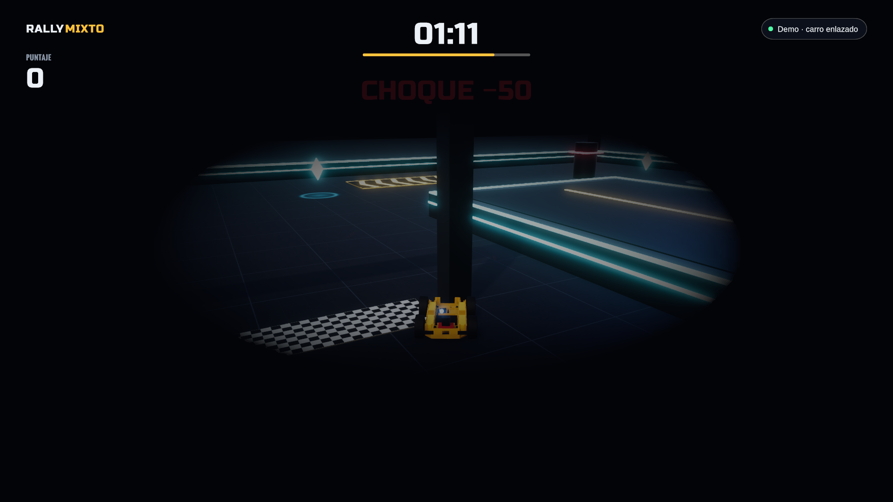

# Rally Mixto · carro ESP32 + Unity

Experiencia físico-digital: un carro a control remoto con dos ESP32 (ESP-NOW) y un juego en Unity que se comunican en los dos sentidos. El joystick del control maneja el carro real y su gemelo digital; lo que pasa en la pista virtual vuelve al hardware como luces, sonido, freno, vibración y límite de velocidad.

Proyecto de Ingeniería Multimedia, Universidad de San Buenaventura Bogotá.



## Contenido

```
├── Car_ESP32/Car_ESP32.ino      # ESP32 del carro (modos RC y AUTO, telemetría, retroalimentación)
├── CONTROLLER/CONTROLLER.ino    # ESP32 del control: joystick + puente Unity (USB/Bluetooth) <-> ESP-NOW
├── Unity/RallyMixto/            # proyecto Unity 6000.3.8f1 (URP)
├── Build/RallyMixto_Windows.zip # ejecutable para Windows
├── Modelado/                    # chasis en Blender y script que exporta el FBX del gemelo
├── Docs/                        # informe IEEE (insumos), figuras y capturas
├── Laboratorio 2/, Taller/      # trabajos anteriores
```

## ¿ESP-NOW y Bluetooth al mismo tiempo?

Sí. El ESP32 clásico (ESP32-WROOM, el de ambas placas) tiene una sola radio de 2.4 GHz que reparte por tiempo entre Wi-Fi (ESP-NOW) y Bluetooth Clásico; el core de Arduino trae activada la coexistencia por software. El control usa:

- **ESP-NOW** (canal 1) hacia el carro, a 20 Hz.
- **Bluetooth Clásico SPP** (`CarroRM-Control`) hacia el PC. Windows lo muestra como un puerto COM.
- **USB** (mismo protocolo) como alternativa por cable.

El carro no usa Bluetooth. El firmware del control ocupa 1.6 MB, por eso necesita la partición **Huge APP**.

## Experiencia en Unity

Flujo: **Conexión (selección del puerto COM) → Menú → Misión manual / Modo automático → Resultados**. La interfaz es mínima: solo lo necesario en cada pantalla.

| Pantalla | Qué hace |
|---|---|
| Conexión | Lista los puertos (USB, BLUETOOTH, SISTEMA), conecta y avisa si el puerto está ocupado, es el del carro o no responde. Incluye modo demostración con teclado. |
| Misión manual | 90 s para recoger celdas. Turbo: el carro real sube al 100 %. Aceite: baja al 35 % y vibra. Choque: freno de 400 ms. Cada evento enciende el LED y suena el zumbador. |
| Modo automático | El carro ejecuta su rutina y el gemelo la replica con la telemetría. Cada paso dispara LED y tono. |

Toda la interfaz es propia (UI Toolkit con tema vacío y estilos en `Assets/_Project/UI/Rally.uss`). Fuentes libres: Russo One, Oswald y Liberation Sans (licencia OFL).

### Retroalimentación Unity → hardware

| Tipo | Dispositivo | Órdenes |
|---|---|---|
| Visual | LED del control (D19) y LED integrado del carro (GPIO2) | `L,p` y `C,p`: apagado, fijo, lento, rápido, destello |
| Sonora | Zumbador del control (D21, opcional) | `T,frecuencia,ms` |
| Física | Motores del carro | `F,ms` freno, `V,ms` vibración, `S,0-100` velocidad permitida |

## Protocolo serial (115200 baudios, texto terminado en `\n`)

| Sentido | Mensaje | Significado |
|---|---|---|
| Control → Unity | `H,CarroRM,2.0` | Saludo (responde a `?`) |
| Control → Unity | `D,x,y,modo,enlace,motA,motB,paso,estado,vel` | Estado cada 50 ms |
| Control → Unity | `E,BTN,modo` | Se pulsó el botón del joystick |
| Unity → Control | `?` / `P` | Saludo / mantener vivo (cada 0.5 s) |
| Unity → Control | `M,0` / `M,1` | Modo automático / manual |
| Unity → Control | `S`, `L`, `C`, `T`, `F`, `V`, `R` | Ver tabla de retroalimentación; `R` reinicia la rutina |

Si el control no recibe nada de Unity durante 3 s vuelve a su comportamiento original (el LED indica el modo y la velocidad queda al 100 %).

Paquetes ESP-NOW: `ctrl_packet` (x, y, modo, velocidad, orden, id de orden, duración, LED del carro) y `car_packet` (motA, motB, modo, paso, estado, velocidad, tiempo). El carro acepta también el paquete antiguo de 5 bytes.

## Materiales

| Carro | Control |
|---|---|
| ESP32 DevKit (38 pines) | ESP32 DevKit |
| Puente H L298N | Joystick KY-023 |
| 4 motores TT con ruedas | LED rojo + resistencia de 220–330 Ω |
| Portapilas / batería | Zumbador (opcional) |

El sensor HC-SR04 se retiró: el modo automático solo ejecuta la rutina.

## Conexiones

**Carro:** D14 → ENA, D27/D26 → IN1/IN2, D25/D33 → IN3/IN4, D32 → ENB, GND común con la batería. Quitar los jumpers de ENA y ENB del L298N.

**Control:** VRx → D35, VRy → D34, SW → D18, VCC → 3V3, GND → GND, LED (+) con resistencia → D19, zumbador (+) → D21.

## Instalación

1. Arduino IDE con **esp32 by Espressif 3.3 o superior**. Placa **ESP32 Dev Module**.
2. Carro: subir `Car_ESP32.ino`. Si aparece `Wrong boot mode detected`, mantener **BOOT** presionado al empezar la carga. Copiar la MAC del Monitor Serie.
3. Control: escribir esa MAC en `receiverAddress`, elegir **Partition Scheme → Huge APP (3MB No OTA/1MB SPIFFS)** y subir `CONTROLLER.ino`.
4. Bluetooth (opcional): en Windows, *Bluetooth y dispositivos → Agregar dispositivo → CarroRM-Control*.
5. Descomprimir `Build/RallyMixto_Windows.zip` y abrir `RallyMixto.exe`. Elegir el puerto del control y pulsar **Conectar**.

Para abrir el proyecto: Unity **6000.3.8f1**, carpeta `Unity/RallyMixto`, escena `Assets/_Project/Scenes/Main.unity`. El menú **Rally Mixto → Configurar proyecto / Compilar Windows** regenera materiales, escena y ejecutable.

## Controles

| Entrada | Acción |
|---|---|
| Joystick | Manejar (carro real y gemelo) |
| Botón del joystick | Cambiar manual / automático (pausa la misión) |
| Esc | Pausa / volver |
| W A S D + Espacio | Joystick y botón en modo demostración |

## Autores

Julian Bello, Andres Clavijo, Axl Umaña y Juan Velasco.

## Referencias

- [ESP-NOW — Espressif](https://docs.espressif.com/projects/esp-idf/en/v5.4/esp32/api-reference/network/esp_now.html)
- [Coexistencia RF del ESP32 — Espressif](https://docs.espressif.com/projects/esp-idf/en/latest/esp32/api-guides/coexist.html)
- [UI Toolkit — Unity](https://docs.unity3d.com/Manual/UIElements.html)
